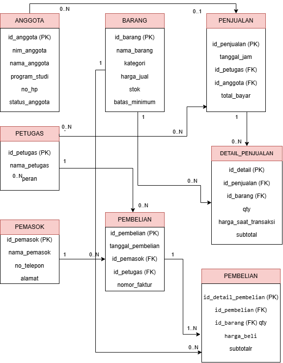
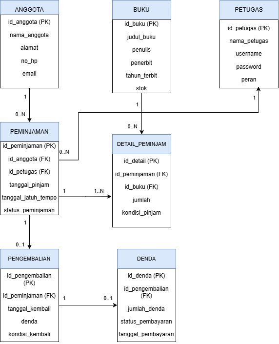

# Laporan Praktikum Basis Data - Pertemuan 03

**Nama:** Rizqi Tri Haryadi  
**NIM:** 25430123  
**Kelas:** B  
**Tanggal:** 13 Oktober 2026

## 1. Tujuan Praktikum

1. Mengidentifikasi entitas, atribut, kunci primer, dan kunci tamu.
2. Menentukan relasi, kardinalitas, dan partisipasi berdasarkan aturan bisnis.
3. Memecah relasi banyak-ke-banyak dengan entitas asosiatif yang memiliki atribut sendiri.
4. Menggambar ERD notasi Crow's Foot dan memvalidasinya terhadap kebutuhan informasi (KI).

## 2. Ringkasan Dasar Teori

Entity-Relationship Diagram (ERD) adalah model konseptual yang menggambarkan entitas, atribut, kunci, dan relasi. Kardinalitas menunjukkan jumlah minimum dan maksimum hubungan, sedangkan partisipasi menunjukkan apakah hubungan wajib atau opsional. Relasi banyak-ke-banyak yang memiliki atribut sendiri perlu diuraikan menggunakan entitas asosiatif. ERD dibuat sebelum penentuan tipe data dan implementasi DBMS.

## 3. Hasil Langkah Percobaan

### 3.1 ERD Kopma

ERD latihan Kopma dibuat menggunakan draw.io. Entitas yang telah digambar adalah `anggota`, `barang`, `petugas`, `penjualan`, `detail_penjualan`, `pemasok`, dan `pembelian`. Atribut kunci diberi penanda PK dan FK.

**Pemeriksaan wajib:** langkah D.1 Modul 3 meminta `pembelian` dipisahkan dari `detail_pembelian`, mengikuti pola penjualan. Karena itu, tambahkan entitas `detail_pembelian` beserta atributnya dari kamus data Pertemuan 2 sebelum menyatakan ERD Kopma final. Periksa pula kunci alternatif seperti `nim_anggota` dan `no_nota_penjualan`, atribut turunan, legenda, serta tanda tangan digital nama dan NIM.

### 3.2 ERD proyek Perpustakaan

ERD proyek yang digambar memuat tujuh entitas berikut:

- `anggota`: `id_anggota` (PK), `nama_anggota`, `alamat`, `no_hp`, `email`.
- `buku`: `id_buku` (PK), `judul_buku`, `penulis`, `penerbit`, `tahun_terbit`, `stok`.
- `petugas`: `id_petugas` (PK), `nama_petugas`, `username`, `password`, `peran`.
- `peminjaman`: `id_peminjaman` (PK), `id_anggota` (FK), `id_petugas` (FK), `tanggal_pinjam`, `tanggal_jatuh_tempo`, `status_peminjaman`.
- `detail_peminjaman`: `id_detail` (PK), `id_peminjaman` (FK), `id_buku` (FK), `jumlah`, `kondisi_pinjam`.
- `pengembalian`: `id_pengembalian` (PK), `id_peminjaman` (FK), `tanggal_kembali`, `denda`, `kondisi_kembali`.
- `denda`: `id_denda` (PK), `id_pengembalian` (FK), `jumlah_denda`, `status_pembayaran`, `tanggal_pembayaran`.

Daftar ini merekam atribut yang sudah dimasukkan ke diagram; cocokkan kembali dengan seluruh atribut dalam kamus data dan dokumen kebutuhan proyek Pertemuan 2 sebelum dikumpulkan.

### 3.3 Relasi dan kardinalitas ERD Kopma

| Relasi | Kardinalitas | Dasar aturan |
|---|---|---|
| Petugas melayani penjualan | Petugas 1 : penjualan 0..N | Wawancara kasir pada Modul 3 |
| Anggota melakukan penjualan | Anggota 0..1 per penjualan; anggota dapat terkait dengan 0..N penjualan | AB-02: penjualan boleh tanpa anggota |
| Penjualan berisi detail penjualan | Penjualan 1 : detail 1..N | AB-01 |
| Barang tercantum pada detail penjualan | Barang 1 : detail 0..N | AB-04 |
| Pemasok menerima pembelian | Pemasok 1 : pembelian 0..N | AB-06 |
| Pembelian berisi detail pembelian | Pembelian 1 : detail 1..N | Faktur pemasok |

Label dan simbol Crow's Foot harus ditempatkan pada ujung garis yang benar. Hubungan penjualan–barang tidak digambar langsung karena atribut seperti `qty` dan harga saat transaksi berada pada `detail_penjualan`.

### 3.4 Relasi dan kardinalitas ERD Perpustakaan

Kardinalitas berikut merupakan rancangan awal dari struktur diagram yang dibuat. Validasi akhir harus mengikuti aturan bisnis serta kode PB/KI yang sebenarnya dalam dokumen Pertemuan 2.

| Relasi | Kardinalitas rancangan | Penjelasan |
|---|---|---|
| Anggota melakukan peminjaman | Anggota 1 : peminjaman 0..N | Setiap peminjaman terkait satu anggota; anggota dapat belum atau memiliki beberapa peminjaman |
| Petugas melayani peminjaman | Petugas 1 : peminjaman 0..N | Setiap peminjaman dicatat satu petugas; petugas dapat mencatat beberapa peminjaman |
| Peminjaman memiliki detail | Peminjaman 1 : detail 1..N | Satu peminjaman berisi minimal satu detail |
| Buku muncul pada detail | Buku 1 : detail 0..N | Satu detail mengacu pada satu buku |
| Peminjaman memiliki pengembalian | Peminjaman 1 : pengembalian 0..1 | Peminjaman dapat belum dikembalikan atau memiliki satu catatan pengembalian |
| Pengembalian memiliki denda | Pengembalian 1 : denda 0..1 | Pengembalian dapat tidak memiliki atau memiliki satu catatan denda |

Jangan menganggap kardinalitas rancangan ini sebagai aturan final apabila dokumen kebutuhan data Pertemuan 2 menetapkan aturan yang berbeda.

### 3.5 Bukti tangkapan layar

Simpan gambar final di folder `laporan/img/` dan masukkan bukti berikut. Pastikan gambar yang disisipkan benar-benar sudah diekspor dari diagram final.

*Keterangan: ERD latihan Kopma.*

*Keterangan: ERD proyek Perpustakaan.*

## 4. Jawaban Titik Analisis

### Titik Analisis 1

**Mengapa `id_anggota` menjadi PK meskipun `no_anggota` dan `nim_anggota` unik? Apa risiko jika NIM menjadi PK?**

`id_anggota` merupakan identitas internal yang stabil dan tidak bergantung pada identitas akademik anggota. Jika NIM dijadikan PK, perubahan NIM dapat memengaruhi tabel lain yang menggunakannya sebagai FK. Kunci pengganti mengurangi dampak perubahan atribut bisnis.

### Titik Analisis 2

**Mengapa sisi penjualan terhadap detail_penjualan bernilai 1..N, bukan 0..N? Dapatkah struktur tabel saja menjaga aturan minimal satu?**

Penjualan harus memiliki minimal satu detail agar menjadi transaksi yang lengkap. FK pada `detail_penjualan` memastikan setiap detail merujuk penjualan yang ada, tetapi tidak memastikan setiap penjualan memiliki detail. Aturan minimal satu perlu dijaga oleh proses validasi transaksi sebelum penjualan disahkan.

### Titik Analisis 3

**Apakah ERD Kopma dapat menjawab “petugas gudang mana yang menerima barang dari pemasok”?**

Jika petugas yang mencatat pembelian selalu merupakan petugas yang menerima barang, hubungan `petugas`–`pembelian` dan `pemasok`–`pembelian` dapat membantu menjawabnya. Jika pencatat dan penerima barang dapat berbeda, perlu ditambahkan relasi atau atribut penerimaan yang merekam petugas penerima. Keputusan ini harus divalidasi dengan pihak Kopma dan dicatat sebagai aturan bisnis.

## 5. Hasil Latihan dan Modifikasi

### 5.1 Poin loyalitas Kopma

Poin loyalitas cukup menjadi atribut pada `anggota` apabila sistem hanya perlu menyimpan saldo terkini. Jika diperlukan riwayat penambahan dan pemakaian poin beserta tanggal dan alasannya, gunakan entitas riwayat poin yang berelasi dengan anggota. Pilihan final mengikuti kebutuhan pada Pertemuan 2.

### 5.2 Relasi banyak-ke-banyak tanpa entitas asosiatif

Jika `penjualan` dan `barang` dihubungkan langsung sebagai banyak-ke-banyak, atribut khusus tiap pasangan transaksi dan barang, seperti kuantitas serta harga saat transaksi, tidak memiliki tempat yang tepat. `detail_penjualan` menjadi entitas asosiatif yang menyimpan FK penjualan dan barang beserta atribut tersebut.

## 6. Tugas Mandiri: Milestone Proyek 3

### 6.1 Berkas wajib

- `p03_erd_kopma_25430123.drawio` dan `p03_erd_kopma_25430123.png`
- `p03_erd_25430123.drawio` dan `p03_erd_25430123.png`
- `laporan/p03_laporan_25430123.md`

Sesuai rencana struktur repositori, berkas diagram dapat ditempatkan di `laporan/erd_kopma/` dan `laporan/erd_perpustakaan/`. Jika diletakkan di lokasi lain, perbarui tautan gambar pada laporan.

### 6.2 Pemetaan entitas ke PB/KI

Isi kode PB dan KI berdasarkan dokumen kebutuhan data Pertemuan 2. Kode tidak dibuat-buat karena tidak terlihat pada diagram yang tersedia.

| Entitas | Jalur informasi yang didukung | Kode PB/KI |
|---|---|---|
| `anggota` | Identitas anggota untuk peminjaman | `[isi sesuai dokumen P2]` |
| `buku` | Informasi buku dan stok | `[isi sesuai dokumen P2]` |
| `petugas` | Petugas pencatat peminjaman | `[isi sesuai dokumen P2]` |
| `peminjaman` | Tanggal, jatuh tempo, dan status peminjaman | `[isi sesuai dokumen P2]` |
| `detail_peminjaman` | Buku dan jumlah pada peminjaman | `[isi sesuai dokumen P2]` |
| `pengembalian` | Tanggal dan kondisi pengembalian | `[isi sesuai dokumen P2]` |
| `denda` | Jumlah dan status pembayaran denda | `[isi sesuai dokumen P2]` |

### 6.3 Penelusuran KI ke jalur ERD

Tabel berikut merupakan contoh jalur konseptual. Lengkapi dengan semua KI resmi dari Pertemuan 2 dan tandai apakah setiap jalur sudah divalidasi.

| Pertanyaan informasi | Jalur ERD | Status |
|---|---|---|
| Siapa anggota yang meminjam? | `anggota → peminjaman` | Cocokkan dengan KI resmi |
| Buku apa saja dalam peminjaman? | `peminjaman → detail_peminjaman → buku` | Cocokkan dengan KI resmi |
| Petugas mana yang mencatat peminjaman? | `petugas → peminjaman` | Cocokkan dengan KI resmi |
| Kapan buku dikembalikan? | `peminjaman → pengembalian` | Cocokkan dengan KI resmi |
| Berapa denda dan status pembayarannya? | `pengembalian → denda` | Cocokkan dengan KI resmi |

### 6.4 Catatan tinjauan klien

Modul 3 meminta minimal dua umpan balik dari teman sekelas yang berperan sebagai klien. Isi tabel ini setelah menerima umpan balik nyata; jangan mengarang tanggapan.

| No. | Umpan balik teman/klien | Keputusan | Alasan |
|---|---|---|---|
| 1 | `[isi umpan balik pertama]` | `[diterima/ditolak]` | `[alasan dan perubahan]` |
| 2 | `[isi umpan balik kedua]` | `[diterima/ditolak]` | `[alasan dan perubahan]` |

### 6.5 Checklist standar ERD konseptual

- [ ] Nama entitas konsisten dan terbaca.
- [ ] Semua atribut kamus data dicantumkan.
- [ ] PK dan FK ditandai dengan benar.
- [ ] Kedua ujung setiap relasi memakai simbol Crow's Foot dan label `1`, `0..1`, `0..N`, atau `1..N`.
- [ ] Setiap relasi dapat dijelaskan sebagai kata kerja dari proses bisnis.
- [ ] Garis tidak menumpuk atau menutupi atribut.
- [ ] Legenda simbol dan kardinalitas diletakkan di bagian bawah diagram.
- [ ] Nama organisasi/proyek dan tanda tangan digital nama serta NIM dicantumkan pada setiap ERD.
- [ ] Semua KI proyek dapat ditelusuri melalui jalur ERD.
- [ ] Dua umpan balik klien dan keputusan beserta alasannya dicatat.

## 7. Pembahasan dan Kendala

ERD membantu memperlihatkan hubungan data yang sebelumnya dituliskan dalam daftar kebutuhan. Entitas asosiatif penting untuk menyimpan atribut yang melekat pada hubungan, seperti kuantitas dan harga pada detail transaksi. Kendala saat menggambar adalah mengatur posisi kotak dan label kardinalitas agar garis tidak bertumpuk.

Sebelum laporan dianggap final, masih perlu diverifikasi: kelengkapan atribut terhadap kamus data Pertemuan 2, keberadaan `detail_pembelian` pada ERD Kopma, kode PB/KI proyek Perpustakaan, legenda dan tanda tangan digital pada diagram, serta umpan balik klien.

## 8. Kesimpulan

ERD merupakan tahap desain konseptual untuk memeriksa entitas, atribut, kunci, relasi, kardinalitas, dan partisipasi. ERD Kopma dan ERD proyek Perpustakaan telah mulai disusun dengan PK/FK dan relasi utama. Sebelum milestone final, kedua diagram perlu divalidasi terhadap aturan bisnis dan KI dari Pertemuan 2, dilengkapi bukti gambar, legenda, tanda tangan digital, serta catatan tinjauan klien.

## 9. Pernyataan Penggunaan AI

Asisten AI digunakan untuk membantu menyusun kerangka laporan dan menjelaskan konsep ERD serta pemeriksaan awal kardinalitas. Diagram dibuat dan disunting di draw.io. Mahasiswa perlu memeriksa isi laporan terhadap buku praktikum, dokumen kebutuhan data Pertemuan 2, diagram final, dan umpan balik klien sebelum mengumpulkan.

## 10. Bukti Git

- **Repositori:** https://github.com/tereliee158-sudo/basisdata-25430123
- **Pesan commit yang diminta modul:** `p03: erd kopma`
- **Hash commit:** `[isi setelah commit dan push selesai]`

## Checklist

- [ ] ERD Kopma tersedia dalam berkas sumber `.drawio` dan gambar `.png`.
- [ ] ERD proyek Perpustakaan tersedia dalam berkas sumber `.drawio` dan gambar `.png`.
- [ ] Bukti tangkapan layar draw.io dengan kardinalitas terbaca ada di `laporan/img/`.
- [ ] Minimal dua umpan balik klien yang nyata dan keputusan dicatat.
- [ ] Setiap entitas dipetakan ke PB/KI dari Pertemuan 2.
- [ ] Tabel relasi dan kardinalitas memakai kode aturan bisnis yang benar.
- [ ] Tabel KI → jalur ERD mencakup semua KI proyek.
- [ ] Minimal satu entitas asosiatif dengan atribut sendiri dibuat.
- [ ] Kedua ERD memenuhi standar kelengkapan Tabel 3.3.
- [ ] Perubahan di-commit dan di-push ke GitHub.
