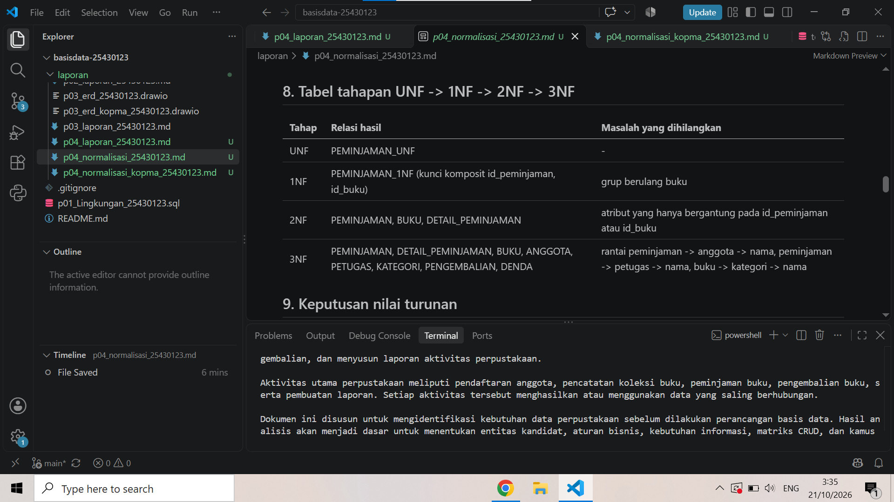
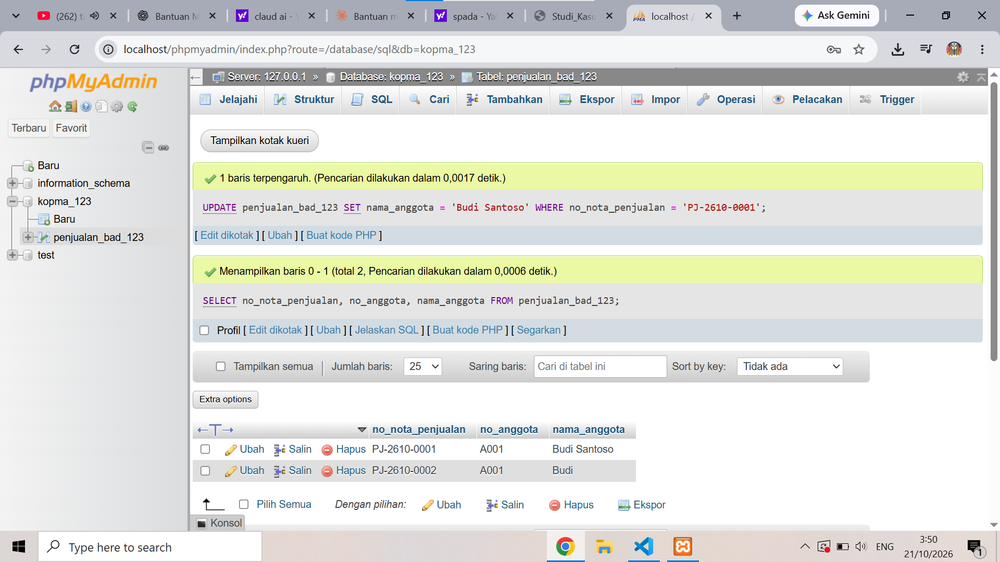

# Laporan Praktikum Basis Data - Pertemuan 04

**Nama:** Rizqi tri Haryadi    **NIM:** 25430123    **Kelas:** b    **Tanggal:** 21 Oktober 2026    **Asisten/Dosen:** Dedi Irawan, S.kom., M.T.I

## 1. Tujuan Praktikum

Praktikum ini bertujuan melatih saya mengenali anomali pada data yang belum dinormalisasi, menuliskan dependensi fungsional dari aturan bisnis, menormalisasi relasi sampai 3NF sambil memeriksa BCNF, serta memutuskan apakah nilai turunan disimpan atau dihitung.

## 2. Ringkasan Dasar Teori

Data yang ditulis berulang dalam satu tabel besar menimbulkan anomali ubah, sisip, dan hapus. Normalisasi mengatasinya dengan memecah tabel supaya satu fakta hanya tersimpan di satu tempat. Dasarnya dependensi fungsional (A -> B), yaitu nilai A selalu menentukan satu nilai B, yang harus diturunkan dari aturan bisnis, bukan dari contoh data. Contoh data hanya dapat membantah sebuah dependensi, tidak dapat membuktikannya. 1NF menghilangkan grup berulang, 2NF menghilangkan ketergantungan pada sebagian kunci, 3NF menghilangkan rantai A -> B -> C, dan BCNF mensyaratkan setiap penentu adalah kunci kandidat.

## 3. Hasil Langkah Percobaan

Seluruh tahapan disimpan di `p04_normalisasi_kopma_25430123.md`.

- **D.1 UNF ke 1NF.** Grup berulang barang dipecah menjadi satu baris per barang per nota, sehingga kunci primer menjadi (no_nota_penjualan, kode_barang).
- **D.2 Dependensi fungsional.** Enam FD diturunkan dari aturan bisnis (AB-01, AB-04, AB-05, dan data master petugas serta barang).
- **D.3 2NF dan 3NF.** Atribut yang bergantung pada sebagian kunci dipisah menjadi `penjualan` dan `barang`; rantai nota -> petugas -> nama dan nota -> anggota -> nama dipisah menjadi `petugas` dan `anggota`. Subtotal, jumlah, dan total tidak disimpan.
- **D.4 Skema kanonik dan BCNF.** Hasil sama dengan Tabel 4.2 kecuali kunci pengganti `id_*` dan tabel pembelian. Kelima tabel memenuhi BCNF.

Bukti tangkapan layar tabel tahapan:



*Gambar 1. Tabel tahapan UNF -> 1NF -> 2NF -> 3NF (ganti dengan tangkapan layar pratinjau Markdown yang memperlihatkan akun ber-NIM dan jam sistem).*

## 4. Jawaban Titik Analisis

**Titik Analisis 1.** FD5 menaruh harga pada kunci (no_nota_penjualan, kode_barang) karena AB-04: harga di nota disimpan per baris dan tidak berubah meski harga barang naik. Jadi harga ditentukan oleh pasangan nota dan barang, bukan barang saja. Jika harga dipindah ke tabel barang, setiap kenaikan harga akan ikut mengubah nota lama. Laporan omzet tahun lalu akan dihitung dengan harga terbaru sehingga angkanya salah.

**Titik Analisis 2.** Pada tabel operasional, total dapat berubah (qty dikoreksi, status anggota berubah) sehingga nilai yang disimpan bisa tidak cocok dengan sumbernya; karena itu total dihitung. Pada tabel arsip, tujuannya potret historis: angka pada saat transaksi harus tetap meski harga atau status anggota kemudian berubah, sehingga menyimpan total justru menjaga laporan lama tidak bergeser. Keduanya konsisten karena sama-sama menjaga kebenaran angka sesuai tujuan tabelnya.

**Titik Analisis 3.** Informasi pemasok barang tersimpan di tabel `pembelian` (kunci tamu id_pemasok) dan `detail_pembelian` (id_pembelian, id_barang), yaitu per transaksi pembelian. Keuntungannya: satu barang dapat dipasok beberapa pemasok dari waktu ke waktu dengan riwayat yang tercatat, ganti pemasok tidak mengubah data master barang, dan nama pemasok hanya tersimpan sekali di tabel `pemasok` sehingga masalah ejaan berubah-ubah seperti di spreadsheet lama tidak terjadi.

## 5. Hasil Latihan dan Modifikasi

**Latihan E.1: beberapa nomor telepon per pemasok.** Nomor telepon adalah atribut bernilai ganda, sehingga tidak boleh ditaruh sebagai satu kolom di `pemasok` (melanggar 1NF). Dibuat relasi baru:

```
PEMASOK         (id_pemasok, nama_pemasok, ...)
TELEPON_PEMASOK (id_pemasok*, no_telepon_pemasok)
-- kunci primer TELEPON_PEMASOK: (id_pemasok, no_telepon_pemasok)
```

**Latihan E.2: anomali ubah jika nama_anggota disimpan di tabel penjualan.** Contoh data yang melanggar 3NF (rantai no_nota -> no_anggota -> nama_anggota):

| no_nota_penjualan | tgl_penjualan | no_anggota | nama_anggota |
|---|---|---|---|
| PJ-2610-0001 | 2026-10-01 | A001 | Budi |
| PJ-2610-0002 | 2026-10-05 | A001 | Budi |

Kueri ubah yang memperlihatkan anomali (jalankan pada tabel uji, beri nama objek memuat NIM/inisial):

```sql
CREATE TABLE penjualan_bad_123 (
  no_nota_penjualan VARCHAR(15) PRIMARY KEY,
  tgl_penjualan DATE,
  no_anggota VARCHAR(10),
  nama_anggota VARCHAR(50)
);
INSERT INTO penjualan_bad_123 VALUES
  ('PJ-2610-0001','2026-10-01','A001','Budi'),
  ('PJ-2610-0002','2026-10-05','A001','Budi');

UPDATE penjualan_bad_123 SET nama_anggota = 'Budi Santoso'
WHERE no_nota_penjualan = 'PJ-2610-0001';

SELECT no_anggota, nama_anggota FROM penjualan_bad_123;
```

Hasil yang diharapkan: anggota A001 muncul dengan dua nama berbeda (`Budi Santoso` dan `Budi`), padahal `no_anggota -> nama_anggota`. Itulah anomali ubah. Setelah dipisah ke tabel `anggota`, nama hanya diubah di satu tempat.



*Gambar 2. Anggota A001 tercatat dengan dua nama berbeda setelah UPDATE pada satu nota.*

## 6. Tugas Mandiri: Milestone Proyek 4

Berkas: `p04_normalisasi_25430123.md` (proyek Perpustakaan, berdasarkan `p02_kebutuhan_data_25430123.md` dan ERD `p03_erd_25430123.png`).

- **Titik awal UNF:** formulir peminjaman buku (p02 bagian 3.1) dengan grup berulang buku.
- **Dependensi fungsional:** delapan FD beserta kode AB (AB-01 sampai AB-10), termasuk dua dependensi yang sengaja tidak dipakai karena tidak didukung aturan bisnis.
- **Tahapan:** 1NF dengan kunci (id_peminjaman, id_buku); 2NF memisahkan peminjaman dan buku; 3NF memisahkan anggota, petugas, dan kategori; hasil akhir delapan tabel yang semuanya memenuhi BCNF.
- **Nilai turunan:** stok tersedia, status peminjaman, dan lama keterlambatan dihitung; jumlah_denda dan tanggal_jatuh_tempo disimpan, masing-masing dengan alasan.
- **Perubahan ERD:** tujuh perubahan (antara lain menghapus `status_peminjaman` dan `denda` di pengembalian, menambah `status_anggota`) dicatat pada bagian 12 berkas tersebut.

## 7. Pembahasan dan Kendala

membedakan 2NF dan 3NF, atau menentukan dependensi fungsional dari aturan bisnis.

## 8. Kesimpulan

Normalisasi menghilangkan anomali dengan memastikan setiap fakta tersimpan di satu tempat. Dependensi fungsional harus diturunkan dari aturan bisnis, dan nilai turunan lebih aman dihitung daripada disimpan pada tabel operasional. Hasil 3NF Kopma terdiri dari penjualan, detail_penjualan, barang, petugas, dan anggota yang semuanya memenuhi BCNF.

## 9. Pernyataan Penggunaan AI

Alat: Claude (Anthropic). Dipakai untuk menjelaskan konsep normalisasi dan dependensi fungsional serta menyusun draf jawaban Langkah D, Titik Analisis 1-3, dan Latihan E pada Kopma. Pemakaian ini sudah diizinkan oleh dosen pengampu Dedi Irawan, S.kom., M.T.I. Bagian yang terbantu: seluruh bagian di atas; pada milestone proyek, draf analisis disusun dengan bantuan AI berdasarkan dokumen p02 dan ERD p03 milik saya, lalu saya tinjau. Saya sudah membaca dan memahami hasilnya serta siap menjelaskannya saat viva.

## 10. Bukti Git

- Repositori: https://github.com/[akun]/basisdata-25430123
- Commit: `[hash]` dengan pesan `p04: normalisasi kopma`

## Checklist

| Butir | Status |
|---|---|
| Identitas lengkap (nama, NIM, kelas, pertemuan, tanggal, asisten/dosen) | [ ] |
| Tujuan dengan bahasa sendiri (maksimal 5 baris) | [x] |
| Ringkasan teori maksimal setengah halaman | [x] |
| Tangkapan layar langkah kunci + keterangan | [ ] |
| Semua Titik Analisis dijawab dengan alasan | [x] |
| Latihan E dengan bukti berjalan (hasil kueri di E.2) | [ ] |
| Tugas Mandiri (F): milestone proyek | [x] |
| Pembahasan dan kendala | [ ] |
| Kesimpulan 2-4 kalimat | [x] |
| Pernyataan Penggunaan AI | [x] |
| Bukti Git (tautan + hash commit) | [ ] |
| Keaslian: akun ber-NIM dan jam sistem pada tangkapan layar | [ ] |
| Khusus P4: berkas p04_normalisasi_25430123.md | [ ] |
| Khusus P4: tabel tahapan UNF-3NF (tangkapan layar) | [ ] |
| Khusus P4: daftar FD + keputusan nilai turunan beserta alasan | [x] |
