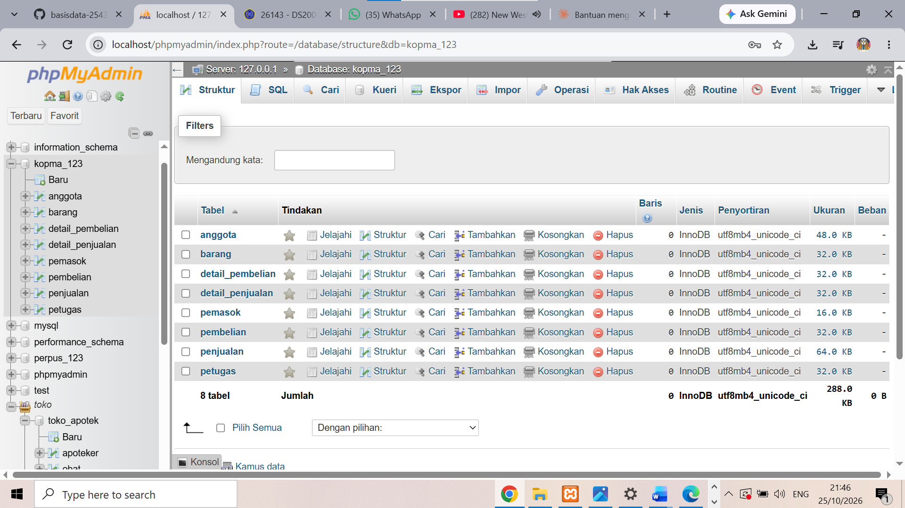
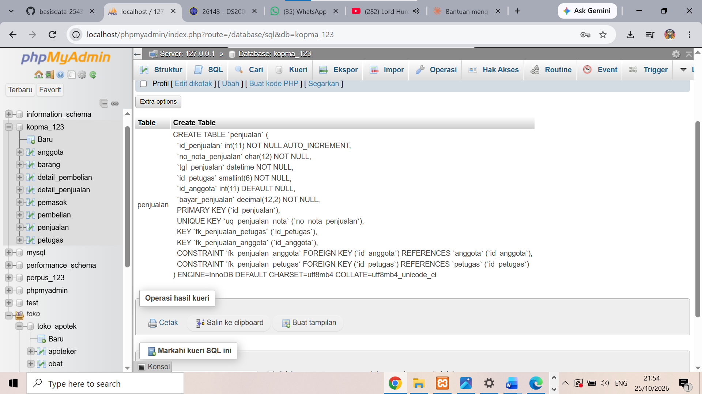
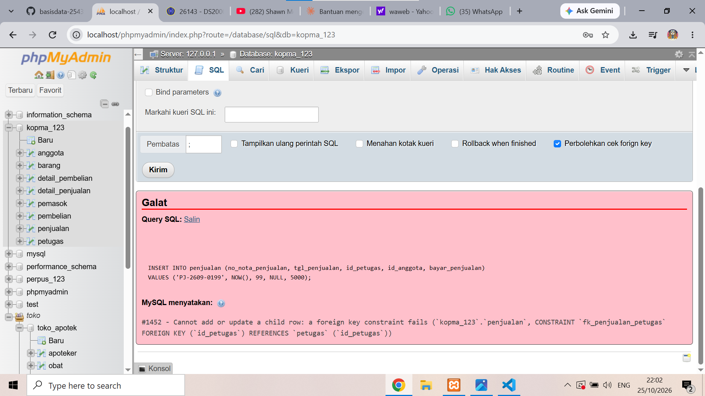
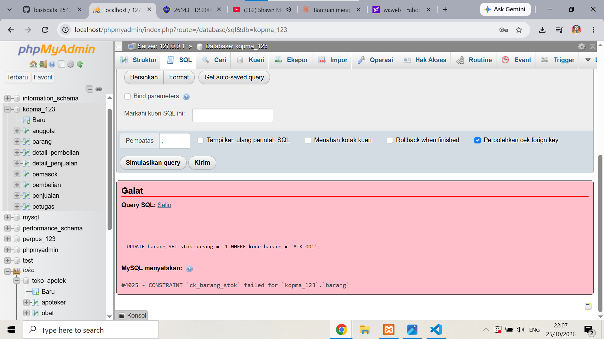
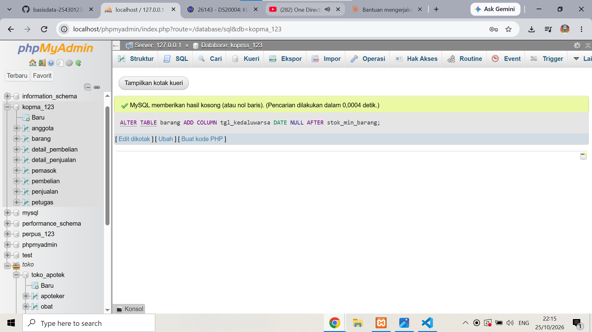
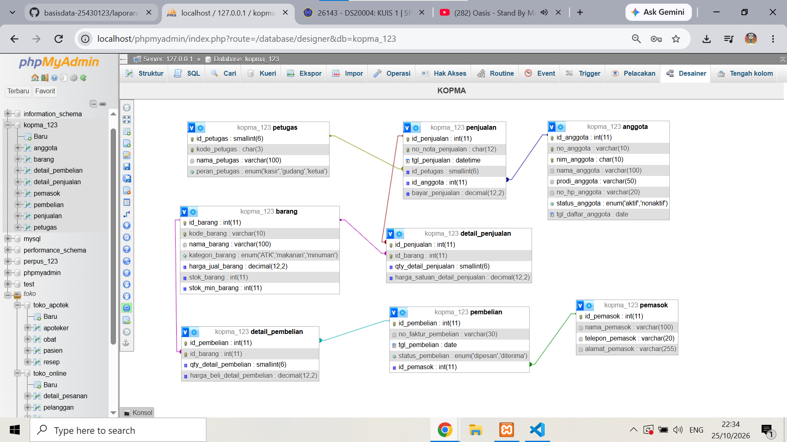
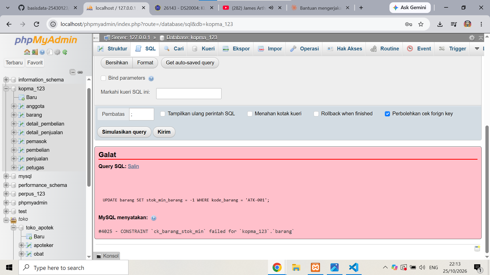
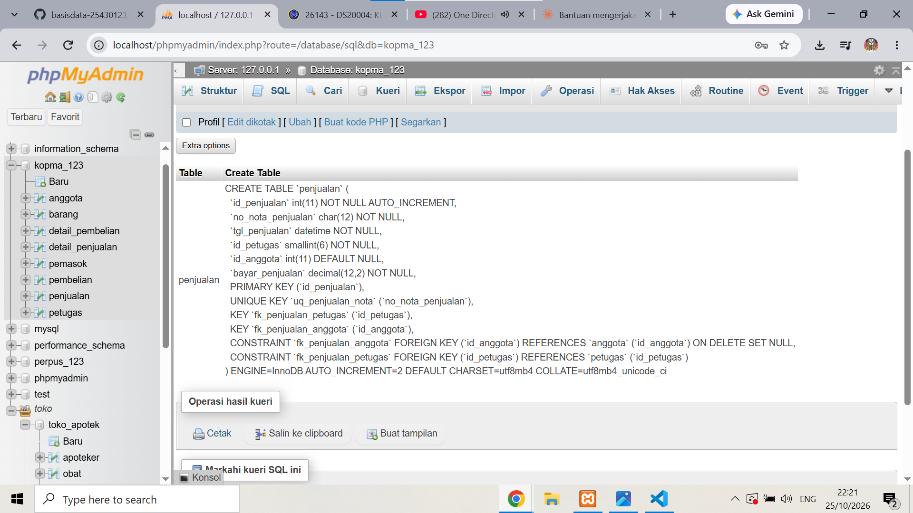

# Laporan Praktikum Basis Data - Pertemuan 05

**Nama:** Rizqi tri Haryadi    **NIM:** 25430123    **Kelas:** b    **Tanggal:** 27 Oktober 2026    **Asisten/Dosen:** Dedi Irawan, S.kom., M.T.I

## 1. Tujuan Praktikum

Praktikum ini bertujuan melatih saya menerjemahkan skema 3NF menjadi perintah CREATE TABLE dengan tipe data yang tepat, menerapkan constraint (PRIMARY KEY, FOREIGN KEY, UNIQUE, NOT NULL, DEFAULT, CHECK) sebagai penjaga aturan bisnis, mengubah struktur dengan ALTER TABLE, serta membuktikan bahwa constraint menolak data yang melanggar aturan.

## 2. Ringkasan Dasar Teori

DDL (Data Definition Language) adalah bagian SQL untuk membuat, mengubah, dan menghapus struktur basis data. Constraint memindahkan aturan bisnis dari "kedisiplinan pengguna" menjadi jaminan server: PRIMARY KEY dan UNIQUE menjaga keunikan, FOREIGN KEY menjaga hubungan antartabel, NOT NULL dan DEFAULT menjaga kelengkapan nilai, dan CHECK menjaga batas nilai satu baris. Tabel induk harus dibuat sebelum tabel anak dan dihapus sesudahnya. Pada MariaDB 10.4, CHECK ditegakkan oleh server sehingga stok negatif dapat ditolak langsung.

## 3. Hasil Langkah Percobaan

Skrip lengkap ada di `p05_ddl_kopma_25430123.sql` dan skrip pengujian di `p05_uji_constraint_kopma_25430123.sql`.

**D.1-D.2: membuat delapan tabel.** Tabel dibuat berurutan dari induk ke anak: petugas, anggota, barang, pemasok, penjualan, detail_penjualan, pembelian, detail_pembelian. Skrip diawali `DROP TABLE IF EXISTS` dari anak ke induk sehingga dapat dijalankan ulang.



*Gambar 1. Delapan tabel Kopma pada basis data kopma_123 (InnoDB, utf8mb4_unicode_ci).*



*Gambar 2. SHOW CREATE TABLE penjualan: kunci unik uq_penjualan_nota dan dua kunci tamu.*

**D.3: pembuktian constraint.** Tiga perintah yang melanggar aturan ditolak server.



*Gambar 3. Galat #1452: nota dengan petugas 99 (tidak ada) ditolak oleh fk_penjualan_petugas.*



*Gambar 4. Galat #4025: stok -1 ditolak oleh ck_barang_stok.*


*Gambar 5. Galat #1062: kode barang ATK-001 kembar ditolak oleh uq_barang_kode.*

**D.4: mengubah struktur.** Kolom `tgl_kedaluwarsa` ditambahkan tanpa membuat ulang tabel, lalu dihapus karena permintaan dibatalkan.



*Gambar 6. ALTER TABLE barang ADD COLUMN tgl_kedaluwarsa berhasil dijalankan.*

**Perbandingan Designer dengan ERD.** Tata letak tabel pada Designer disusun mirip ERD Pertemuan 3.



*Gambar 7. Designer phpMyAdmin untuk kopma_123: delapan tabel dan tujuh garis relasi.*

Perbedaan antara desain fisik dan ERD Pertemuan 3:

| Unsur | ERD Pertemuan 3 | Desain fisik (DDL) | Alasan |
|---|---|---|---|
| Nama kolom | ringkas: `tanggal_jam`, `harga_jual`, `stok`, `batas_minimum`, `program_studi`, `no_hp`, `qty` | berakhiran nama tabel: `tgl_penjualan`, `harga_jual_barang`, `stok_barang`, `stok_min_barang`, `prodi_anggota`, `no_hp_anggota`, `qty_detail_penjualan` | standar penamaan buku |
| Kolom tambahan | tidak ada | `kode_petugas`, `kode_barang`, `no_anggota`, `tgl_daftar_anggota`, `status_pembelian` | kode unik dan data pendukung aturan bisnis |
| `subtotal` pada kedua tabel detail | ada | tidak ada | nilai turunan, tidak disimpan (keputusan Modul 4) |
| `total_bayar` pada penjualan | ada | `bayar_penjualan` | yang disimpan adalah uang yang diterima; total dihitung dari detail |
| Kunci primer tabel detail | `id_detail`, `id_detail_pembelian` | komposit (id_penjualan, id_barang) dan (id_pembelian, id_barang) | sesuai skema kanonik Tabel 4.2 |
| `id_petugas` pada pembelian | ada | tidak ada | skema kanonik Tabel 4.2 hanya memberi pembelian kunci tamu id_pemasok. Dicatat sebagai perbedaan, bukan diubah. |
| Constraint (UNIQUE, CHECK, DEFAULT, ON DELETE) | tidak digambar | ada di DDL | Designer juga hanya menampilkan tipe data dan relasi, bukan constraint |

Catatan: dokumen p02 Kopma juga memuat entitas Kategori, Pembayaran, dan Riwayat Poin (AB-06 sampai AB-10) yang tidak diimplementasikan pada Pertemuan 5, karena skema fisik mengikuti ERD Pertemuan 3 dan skema kanonik buku.

## 4. Jawaban Titik Analisis

**Titik Analisis 1.** `fk_detail_penjualan` memakai `ON DELETE CASCADE` karena detail adalah bagian dari nota: jika nota dibatalkan dan dihapus, rinciannya tidak bermakna tanpa kepala nota sehingga ikut terhapus. `fk_detail_barang` tidak memakainya karena barang yang pernah terjual tidak boleh dihapus. Jika barang boleh dihapus beserta seluruh detailnya, baris detail pada nota-nota lama ikut hilang. Nota tinggal tanpa rincian, `bayar_penjualan` tidak cocok dengan rinciannya, dan laporan omzet atau barang terlaris periode lama menjadi tidak akurat.

**Titik Analisis 2.**

| Galat | Constraint | Aturan yang dilindungi |
|---|---|---|
| 1452 | fk_penjualan_petugas | setiap transaksi harus terhubung dengan petugas yang valid (p02 bagian 9, butir Integritas; bukan kode AB tersendiri) |
| 4025 | ck_barang_stok | AB-05: stok barang tidak boleh menjadi negatif setelah transaksi penjualan |
| 1062 | uq_barang_kode | AB-02: setiap barang memiliki identitas yang unik (dijaga lewat kunci unik `kode_barang`) |

Aturan yang belum dapat dijaga oleh constraint apa pun adalah aturan yang melibatkan banyak baris atau banyak tabel: AB-05 pada bagian stok yang harus berkurang dan tidak boleh negatif setelah transaksi (CHECK hanya menjaga hasil akhirnya, bukan penolakan penjualan yang qty-nya melebihi stok), AB-06 bahwa pembayaran sesuai dengan transaksinya, serta AB-07 sampai AB-10 tentang perolehan dan penukaran poin loyalitas, termasuk pembaruan saldo poin. Semua itu memerlukan perhitungan antarbaris atau antartabel dan diselesaikan pada pertemuan transaksi dan trigger (Pertemuan 14).

**Titik Analisis 3.** `DROP TABLE IF EXISTS` harus dimulai dari `detail_pembelian` dan `detail_penjualan` karena tabel anak memiliki kunci tamu yang merujuk tabel induk. Jika `petugas` dihapus lebih dulu, server menolaknya karena masih dirujuk oleh `penjualan`, dengan galat jenis 1451 (menurut buku, pesan "Cannot delete or update a parent row" / constraint yang merujuk). [Opsional: jalankan `DROP TABLE petugas;` dan catat pesan galat yang muncul pada komputermu sebagai bukti.]

## 5. Hasil Latihan dan Modifikasi

**Latihan E.1: CHECK stok minimum tidak negatif.**

```sql
ALTER TABLE barang ADD CONSTRAINT ck_barang_stok_min CHECK (stok_min_barang >= 0);
UPDATE barang SET stok_min_barang = -1 WHERE kode_barang = 'ATK-001';
```



*Gambar 8. Galat #4025: stok_min_barang -1 ditolak oleh ck_barang_stok_min.*

**Latihan E.2: ON DELETE SET NULL pada fk_penjualan_anggota.**

```sql
ALTER TABLE penjualan DROP FOREIGN KEY fk_penjualan_anggota;
ALTER TABLE penjualan
  ADD CONSTRAINT fk_penjualan_anggota FOREIGN KEY (id_anggota)
  REFERENCES anggota (id_anggota) ON DELETE SET NULL;
```



*Gambar 9. fk_penjualan_anggota kini berakhiran ON DELETE SET NULL.*

Pembahasan: perubahan ini sesuai dengan sifat Kopma yang melayani anggota maupun nonanggota (p02 bagian 1), sehingga nota yang anggotanya dihapus tetap sah dan omzetnya tetap tercatat. Dari sisi pelindungan data pribadi (UU PDP), penghapusan anggota tidak meninggalkan identitasnya pada nota. Konsekuensinya, riwayat belanja anggota itu tidak dapat ditelusuri lagi dan nota lama yang menjadi dasar poin loyalitas atau potongan harga (AB-07 sampai AB-09) tidak lagi menunjukkan anggotanya, yang dapat mempersulit audit saldo poin.

## 6. Pemetaan Tipe Data dan Alasan Constraint

| Elemen | Tipe | Alasan |
|---|---|---|
| nim_anggota | CHAR(10) | panjang tetap, berupa kode, bukan angka untuk dihitung |
| no_nota_penjualan | CHAR(12) | format tetap PJ-YYMM-nnnn |
| harga_jual_barang, harga_satuan_detail_penjualan | DECIMAL(12,2) | uang harus tepat; FLOAT menimbulkan galat pembulatan |
| stok_barang, stok_min_barang | INT | bilangan bulat |
| qty_detail_penjualan | SMALLINT | jumlah per baris nota kecil |
| tgl_penjualan | DATETIME | laporan harian memerlukan tanggal dan jam |
| status_anggota, peran_petugas, kategori_barang, status_pembelian | ENUM | nilai terbatas dan diketahui |

Constraint dipilih sesuai aturan bisnis: UNIQUE untuk identitas anggota (AB-01), identitas barang (AB-02), dan nomor transaksi (AB-03); CHECK untuk jumlah lebih dari nol (AB-04) dan stok tidak negatif (AB-05); FOREIGN KEY untuk integritas referensial; serta ON DELETE CASCADE hanya pada detail. Catatan: MariaDB selalu menamai kunci primer `PRIMARY`, sehingga nama `pk_...` pada skrip berfungsi sebagai dokumentasi.

## 7. Tugas Mandiri: Milestone Proyek 5

[Belum dikerjakan. Diisi setelah `p05_ddl_25430123.sql` untuk proyek Perpustakaan, ERD fisik proyek, tabel pemetaan tipe data, dan hasil perbandingan Designer dengan ERD proyek selesai.]

## 8. Pembahasan dan Kendala

[Tulis dengan pengalaman sendiri: bagian yang sulit (misalnya membaca pesan galat, atau memahami urutan membuat dan menghapus tabel), cara mengatasinya, dan hal yang baru dipahami.]

## 9. Kesimpulan

Constraint memindahkan aturan bisnis dari kedisiplinan pengguna menjadi jaminan server, terbukti dari tiga galat (1452, 4025, 1062) yang menolak data melanggar aturan. Aturan yang melibatkan banyak baris tidak dapat dijaga constraint dan perlu transaksi serta trigger pada pertemuan berikutnya. Desain fisik Kopma terdiri dari delapan tabel yang berbeda dari ERD konseptual terutama pada penamaan kolom, nilai turunan, dan kunci primer tabel detail.

## 10. Pernyataan Penggunaan AI

Alat: Claude (Anthropic). Dipakai untuk menyusun draf skrip DDL dan skrip pengujian, memberi panduan langkah demi langkah, serta menyusun draf jawaban Titik Analisis dan perbandingan Designer dengan ERD. Pemakaian ini sudah diizinkan oleh dosen pengampu [nama dosen]. Saya sendiri menjalankan skrip di phpMyAdmin, mengambil seluruh tangkapan layar, dan memeriksa hasilnya, serta siap menjelaskannya saat viva.

## 11. Bukti Git

- Repositori: https://github.com/tereliee158-sudo/basisdata-25430123
- Commit: `7a0bedc` dengan pesan `p05: ddl kopma`

## Checklist

| Butir | Status |
|---|---|
| Identitas lengkap | [ ] |
| Tujuan dengan bahasa sendiri | [x] |
| Ringkasan teori maksimal setengah halaman | [x] |
| Tangkapan layar langkah kunci + keterangan | [x] |
| Semua Titik Analisis dijawab dengan alasan | [x] |
| Latihan E dengan bukti berjalan | [x] |
| Tugas Mandiri (F): milestone proyek | [ ] |
| Pembahasan dan kendala | [ ] |
| Kesimpulan 2-4 kalimat | [x] |
| Pernyataan Penggunaan AI | [ ] (lengkapi nama dosen) |
| Bukti Git (tautan + hash commit) | [ ] |
| Keaslian: akun ber-NIM dan jam sistem pada tangkapan layar | [x] |
| Khusus P5: p05_ddl_NIM.sql dapat dijalankan ulang | [ ] (proyek) |
| Khusus P5: ERD fisik p05_erd_fisik_NIM | [ ] |
| Khusus P5: SHOW CREATE TABLE dan galat FK/UNIQUE/CHECK | [x] |
| Khusus P5: alasan tipe data dan kaitan constraint dengan AB-xx | [x] |
